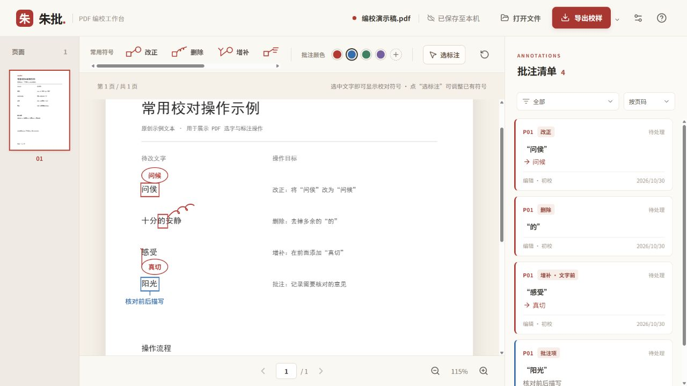
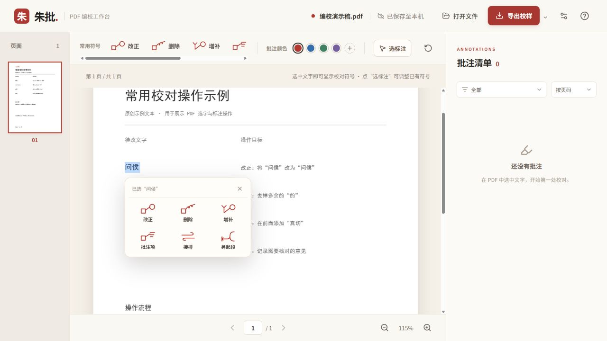

# 朱批 · PDF 编校工作台

在 PDF 原页上选中文字，添加校对符号，并导出带批注的校样或修改清单。

朱批是一个本地优先的网页应用。PDF 和批注在浏览器内处理，以独立工程数据保存；现有功能不调用 AI 接口，不需要 API Key 或 ChatGPT 账号。

[在线体验](https://zhupi-proofreader.elvensole9.chatgpt.site/) · [MIT 许可证](LICENSE) · [参与开发](CONTRIBUTING.md)

> 在线演示的可达性取决于所在网络。可以下载源码本地运行，或部署到自己的静态网站托管服务。



## 功能

- **六种校对标记**：改正、删除、增补、批注项、接排、另起段。
- **原页选字**：拖选文字后弹出工具条，单击一个字或标点也可选中。
- **增补位置**：可以在所选文字前或文字后添加内容。
- **标注调整**：切换“选标注”模式后，可调整已有标记的位置、大小以及删除尾巴方向；提供撤销。
- **批注管理**：按页码或时间排序，按状态、颜色、标注人及校次筛选；记录待处理、已采纳、已驳回状态。
- **颜色与文字**：预设四色、自定义颜色，以及批注文字颜色和字号设置。
- **导出**：带批注 PDF、原样 PDF、Excel 修改清单、Word 修改清单。
- **工程续改**：导出 `.zhupi` 工程，包含原 PDF 和批注；另一设备导入后可以继续修改。
- **本地保存**：在当前浏览器的 IndexedDB 中自动保存。



## 适用范围

- 适用于可以选中文字的 PDF。扫描图片型 PDF 暂未提供 OCR。
- 这是**手动编校工具**，不会自动查错或生成改写建议。
- 标注不直接替换原 PDF 正文。“带批注 PDF”保留原文并绘制修改痕迹；“干净 PDF”导出的是原始 PDF，并不是已采纳全部修改的文档。
- 未覆盖完整的校对符号标准；当前实现以上六种标记。
- 跨设备需要手动导出、导入工程文件，目前没有账号系统或云同步服务。
- 字体、排版和浏览器环境可能影响文字选择与显示，正式交付前应检查导出的校样。

## 本地运行

需要 **Node.js 22.13+，建议使用 Node.js 24**，以及随 Node.js 安装的 npm。

```bash
git clone https://github.com/qingbeilanyue/zhupi-proofreader.git
cd zhupi-proofreader
npm ci
npm run dev
```

在浏览器打开终端显示的本地地址。默认监听 `0.0.0.0`，同一局域网内的设备也可访问开发服务。

## 使用流程

1. 选择或拖入 PDF，或者导入已有 `.zhupi` 工程。
2. 在页面上选中字词，在悬浮条选择校对标记。
3. 改正、增补和批注项可填写文字；增补可指定文字前或文字后。
4. 在右侧清单核对意见、记录处理状态，必要时点“选标注”调整标记。
5. 导出带批注 PDF 或修改清单；需要备份或换设备时导出工程文件。

快捷键：`R` 改正、`D` 删除、`I` 增补、`C` 批注项、`J` 接排、`P` 另起段、`Esc` 返回选字、`Delete` 删除选中的标注、`Ctrl/⌘ + Z` 撤销。

## 检查与构建

```bash
npm run test:geometry
npm run build
npm run preview
```

`test:geometry` 检查文字选区合并、校对符号几何及引线等逻辑。`build` 执行 TypeScript 检查并生成生产构建。GitHub Actions 会在推送和 Pull Request 时执行这两项检查。

这不是完整的浏览器端端到端测试套件。修改 PDF 解析、选字或导出逻辑后，还应使用真实 PDF 手动验证。

## 自行部署

本项目无需应用后端。执行 `npm run build` 后，将 **`dist/` 内的全部文件**部署到静态网站托管服务即可。

- 使用域名根路径部署，提供 `index.html`、JavaScript、CSS、PDF worker 及 PWA 文件。
- 推荐 HTTPS；PWA 安装和 Service Worker 需要 HTTPS 或 `localhost`。
- 发布新版本时同时上传入口文件和对应的带哈希资源。
- 如需部署到子路径，必须一并调整 Vite `base`、页面中的绝对资源路径、PWA manifest 和 Service Worker 路径。
- 站点权限、域名及备案由所选托管平台配置；公开源码不代表附带托管服务或永久在线承诺。

## 项目结构

```text
src/
  App.tsx          PDF 工作台、批注交互和界面
  model.ts         数据模型、选区合并与校对符号几何
  textSelection.ts PDF 文字选择与字形定位
  pdfMarks.ts      PDF 标注绘制
  export.ts        PDF、Excel、Word 和工程文件导出
  storage.ts       IndexedDB 存储及文件下载
public/            图标、Web App manifest 和 Service Worker
scripts/           几何检查脚本
docs/images/       原创演示稿的实际操作截图
```

主要依赖：React、TypeScript、Vite、PDF.js、pdf-lib、ExcelJS、docx 和 JSZip。

PDF.js 主线程与 worker 都使用 `legacy` 兼容构建，以处理缺少 `Uint8Array.prototype.toHex()` 等新接口的浏览器环境。调整导入时应保持两者配套。

## 隐私与备份

当前应用代码不将 PDF 或批注上传到应用服务器。网页资源由托管平台提供；托管平台可能记录正常的网页访问日志。

本地数据按浏览器、设备和网站来源隔离。更换域名、清理浏览器数据或使用隐私模式时，原有记录可能无法访问；请定期导出 `.zhupi` 工程备份。跨设备续改不是自动云同步。

## 开源许可

项目自身代码采用 [MIT License](LICENSE)，版权归 `qingbeilanyue` 所有。第三方依赖保留其各自许可证，见 [THIRD_PARTY_NOTICES.md](THIRD_PARTY_NOTICES.md)。

README 截图使用原创演示内容，不包含客户稿件。
